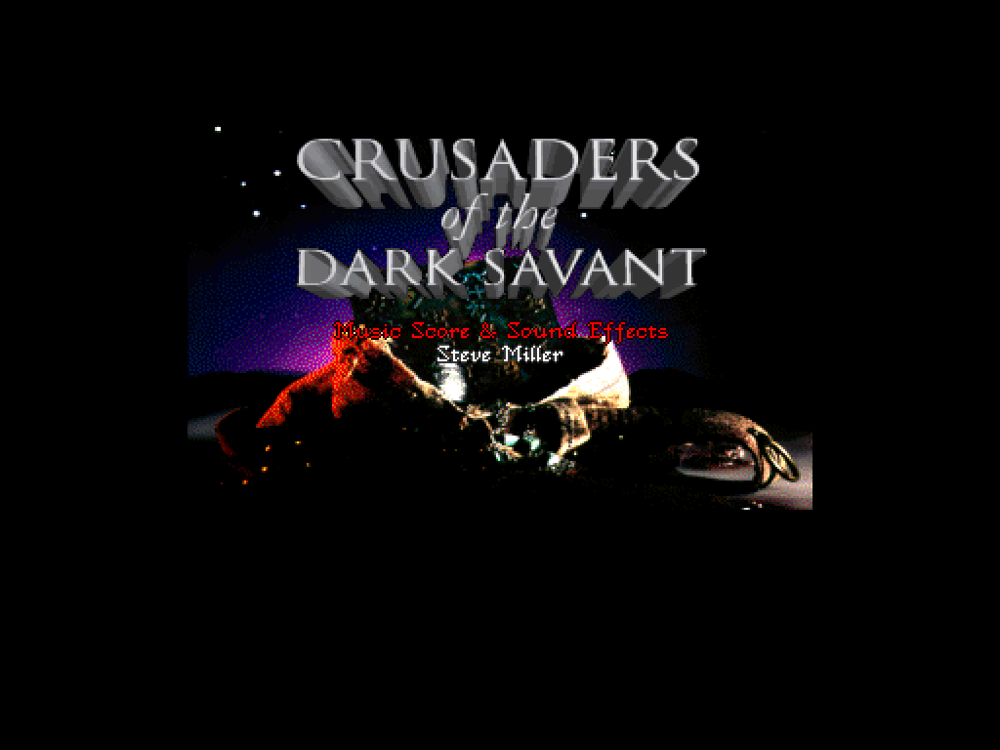
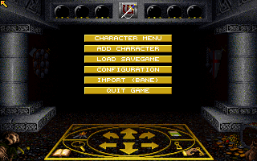
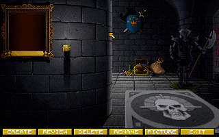
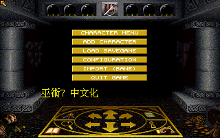

# 巫術7 繁體中文化

《巫術7》（*Wizardry VII: Crusaders of the Dark Savant*，Sir-Tech 1992）DOS 版的繁體中文化。
做法不是重寫遊戲：原版 `DS.EXE` 原封不動跑在 [dosgolem](https://github.com/wicanr2/dosgolem)
（無頭、決定性的 DOS 執行器）上，轉譯層在原版畫字的那一刻攔下來，
把中文畫在放大後的畫布上。原版邏輯一行不動。



片頭標題頁（Crusaders of the Dark Savant）。dosgolem 執行原版 `DS.EXE` 的實跑輸出，
模式 13h（320×200、256 色），照 4:3 顯示比例輸出。

## 這是什麼遊戲

Sir-Tech 1992 年推出的《巫術》系列第七作，總設計 David W. Bradley。
第一人稱迷宮 RPG：組隊、在迷宮裡一格一格推進、打怪練等；
對話、咒語、道具、NPC 全部是英文。安裝程式 `VINSTALL.EXE` 裡的版權字串：

```
Crusaders of the Dark Savant Application Software
Copyright (C) 1992 by David W. Bradley and Sir-Tech Software, Inc.
```

原版是 DOS 磁片版，架構是主執行檔加 overlay：`DS.EXE`（69,206 bytes）常駐，
迷宮、戰鬥、角色、城鎮、寶物等模組放在 13 個 `.OVR` 檔裡按需載入
（VINIT、VBASE、VPCVW、VPCLV、VPCMK、VMAZE、VMEXT、VMELE、VPOPS、VMEXE、VDOPT、VTREA、VMNPC）。
硬體支援面很寬：五種顯示模式（VGA/MCGA 256 色、EGA 16 色、CGA、Hercules、Tandy）、
Sound Blaster 與 Roland MT-32/LAPC-1 音效、滑鼠；需要 580K 傳統記憶體與 x87 浮點運算器。

啟動批次檔的錯誤碼目錄裡有 "Password Verification Error"，原版有密碼式防拷
（形態待查）。散布版並附 Mo'Slo CPU 降速器，先降速再跑遊戲——
它的行為與 CPU 速度相關，這點在模擬器上要正視。

本專案手上的版本是 1998 年前後 Interplay《Wizardry Archives》合輯裡的重印
（`CDSBOOT.TXT` 落款 1998 Sir-tech，全部檔案日期 1996-12-24），不是 1992 年的原始磁片。
位址表與雜湊基線都對這個重印版成立。

## 為什麼做中文化

縮短語言隔閡與鴻溝——讓不諳英文的玩家也能玩到這款經典。其他取捨都以這條為準。

這款的文字量在系列裡數得上：訊息檔 `MSG.DBS` 有 262,144 bytes，劇本檔 `SCENARIO.DBS`
有 368,320 bytes，對話、物品說明、NPC 反應都在裡面（目前仍是編碼過的資料，格式待解）。
不懂英文的話，這些內容就是整個遊戲。目標是把遊戲內文字全部換成繁體中文，
人名、地名、咒語、道具集中一份譯名表，台灣既有譯名優先。

## 怎麼做

原版 `DS.EXE` 零修改跑在 dosgolem 上，CPU、DOS/BIOS、VGA、音效由它模擬；
轉譯層在原版呼叫印字常式的那一刻攔下來，把中文點陣字畫在整數倍放大後的畫布上，
不去擠原版的字格。翻譯有缺就顯示原文並記錄，不靜默略過。
執行節拍綁 CPU 指令數（原版靠 Mo'Slo 降速，dosgolem 對應的是 cycles 對齊）。

目前到哪裡——M0（探勘與基線）完成，M1（原版在 golem 上完整可跑）大部分完成：

| 項目 | 現況 | 證據 |
|---|---|---|
| 開機到主選單 | 已可達：開機 → 片頭 → 穩定標題（約 520M 步）→ 故事畫面 → 主選單（940M 步檢查點）。目前靠檢查點與腳本點擊推進 | [`docs/re/003`](docs/re/003-golem-boot.md)、[`006`](docs/re/006-m1-progress.md)、[`009`](docs/re/009-round3.md) |
| 與 DOSBox-X 對拍 | 穩定標題逐像素比較：版面差異 0、RGB 差異 0（容差 0）；同輸入下兩個模擬器收斂到同一張畫面 | [`docs/re/005`](docs/re/005-dosboxx-parity.md)、[`009`](docs/re/009-round3.md) |
| 決定性 | 同一輸入跑兩次：狀態檔、記憶體 dump、跨 run 幀雜湊全同 | [`docs/re/009`](docs/re/009-round3.md) |
| 事件投遞 | 修好 dosgolem 缺的 `INT 33h AX=14h`（滑鼠 handler 註冊），主選單五列都能用真實點擊推進，修復已併入 dosgolem 上游 | [`docs/re/007`](docs/re/007-story-wait-vgadrv.md)、[`008`](docs/re/008-int33-ax14-fix.md) |
| 逆向普查 | `DS.EXE` 加 13 個 overlay 共 843 個函式（下界）、390,321 code bytes；所有 DOS/BIOS/EMS 呼叫集中在常駐部，overlay 經 far call 進服務層 | [`docs/re/004`](docs/re/004-ida-census.md) |
| 執行期組態 | 本安裝走模式 13h、OPL2 音效（埠 388/389）、EMS、滑鼠；動畫由計時器推進 | [`docs/re/003`](docs/re/003-golem-boot.md) |

還沒做的：

- OPL2 音效事件層與 DOSBox-X 的逐筆對拍（M1 收尾）。
- 從主選單往下走：建隊伍、進遊戲（模擬試玩，M2）。
- M2 圖形前端：骨架開發中，目前還沒有可以給玩家執行的程式。
- M3 文字攔截與抽取（`MSG.DBS` 等資料檔的格式還沒解）。
- M4 中文繪製與全文翻譯、M5 輔助功能。

未完成項的權威是 [`docs/worklist.json`](docs/worklist.json)，一條對應一個 GitHub issue。



主選單（五列選單項）。dosgolem 執行原版 `DS.EXE` 的實跑輸出，
從 940M 步的檢查點展開，640×400 ＝ 320×200 整數倍放大 2 倍。



點擊主選單第一列後的畫面（PCVWSCRN 底圖）。dosgolem 實跑輸出：
滑鼠事件投遞到遊戲自己註冊的 handler 後推進的畫面，與 DOSBox-X 同輸入逐像素一致。



第一個中文字畫面：以 probe `-poke` 將 PIL 渲染的中文點陣（AR PL UMing 字型）
寫入 VRAM，主選單畫面即時顯示「巫術7 中文化」。翻譯層（M4）的基礎管線已通。

## 原版要自備

本 repo 不含 `DS.EXE`、`.OVR`、`.VGA`、`.PIC`、`.HDR`、`.SND` 等任何原版檔案，
也不提供取得管道。之後的可散布發行包同樣不含，打包時會掃一遍確認沒有夾帶。
要跑這個中文化，需要自備 DOS 版《巫術7》。

目前驗證過的版本是 Interplay《Wizardry Archives》合輯裡的重印（檔案日期 1996-12-24），
共 248 個檔案、5,414,248 bytes。關鍵檔案：

| 檔案 | 大小 | SHA-256 |
|---|---:|---|
| `DS.EXE` | 69,206 | `14a94f85cb4ef4df08566ed165dddc88c363aa816360c6509b84f079866a43db` |

全部 248 檔的 SHA-256 基線在 [`docs/re/001`](docs/re/001-unzip-baseline.md)。
位址表只對這個版本成立；文本抽取與之後的工具會先驗雜湊，不符就停下列出不符的檔案，不猜測。

## 文件

- [`PLAN.md`](PLAN.md)：路線、分期、與前一個專案 psychic-war 的差異與風險。
- [`docs/goal/`](docs/goal/)：分期目標與驗收條件。
- [`docs/re/`](docs/re/)：反組譯與量測紀錄，每項結論帶推論等級標籤
  （confirmed／強證據／假說／未知）。
- [`docs/worklist.json`](docs/worklist.json)：未完成項的權威。

## 授權

本作品將採 **RRSAL-1.0**（復古重製 source-available 授權條款；`LICENSE` 檔建立後，
全文以 [`LICENSE`](LICENSE) 為準）。摘要：

- 非商業使用免費，可以修改、可以再散布。
- 實況、錄影、截圖與教學明示允許。
- 修改後散布要附上原始碼與修改說明；貢獻回授本專案。
- 商業使用要另外談，聯絡 wicanr2@gmail.com。

**授權不涵蓋原版素材。** 原版的程式、圖、音樂與文字屬於 Sir-Tech、Interplay
與原權利人，使用本作品必須自備合法的原版副本。repo 裡為了研究與對照保留的
原版片段（雜湊基線、量測得出的位址表、含原版底圖的截圖）不在授權範圍內。

本專案與 Sir-Tech、Interplay 沒有隸屬、合作、贊助或授權關係，
是獨立的第三方保存與研究專案。
