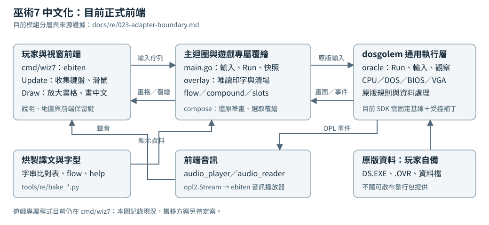

# 巫術7 繁體中文化

《巫術7》（*Wizardry VII: Crusaders of the Dark Savant*，Sir-Tech 1992）DOS 版的繁體中文化。
原版 `DS.EXE` 在 [dosgolem](https://github.com/wicanr2/dosgolem) 上執行，轉譯層辨識玩家可見輸出，
在放大後的畫布覆繪中文。目的是讓不諳英文的玩家也能理解迷宮、對話與角色資訊。

玩家須自備合法的原版遊戲。可散布發行包不提供原版程式、資料、美術、音樂、手冊或防拷答案。

## 故事背景

《巫術7》的冒險承接《巫術6：Bane of the Cosmic Forge》。前作追尋的「宇宙鍛爐」（Cosmic Forge）其實是一支魔法筆，能改寫時間、空間與命運。當這支筆失落，原本受到掩藏的行星也失去屏障。一艘意外偏離航路的太空船發現了它，消息隨即傳遍星際。那顆不在星圖上的世界，被認為就是傳說中失落的嘉迪亞（Guardia）。[官方故事介紹](https://wizardry.info/en/product/game/wizardry-7-crusaders-of-the-dark-savant/)、[官方商店的前作介紹](https://www.gog.com/en/game/wizardry_6_7)。

嘉迪亞的傳說與豐贊（Phoonzang）有關。這位藝術家與科學天才發現了宇宙與生命的重大秘密，卻擔心它落入野心家手中。他將成果封存在球形神器「星界統領」（Astral Dominae）之內，藏在嘉迪亞，並把通往藏所的地圖拆散。對外來者而言，尋找神器也意味著理解這個世界留下的文明、信仰與線索。[原版背景故事轉錄](https://www.tk421.net/wizardry/wiz7story.shtml)。

行星重見天日後，爭奪秘密的勢力相繼到來。軍事力量強大的恩帕尼（Umpani）與掌握廣大交易網絡的特蘭格（T'Rang）互為競爭者；乘著黑船穿行星際的黑暗賢者（Dark Savant），則為自己的目的追尋星界統領。他身邊還有戰士薇·多米娜（Vi Domina），據說是豐贊的後裔，可能掌握開啟秘密的關鍵。她與黑暗賢者的關係，也成為冒險中的疑問。[原版背景故事轉錄](https://www.tk421.net/wizardry/wiz7story.shtml)。

嘉迪亞也有自己的居民、組織與傳說。外來勢力眼中的寶藏，對當地居民可能有完全不同的意義。玩家踏上這片土地時，面對的是森林、城鎮、地下迷宮與古老遺跡，也是一張由不同立場構成的人際網絡。誰值得相信、哪些線索相互呼應，都要在旅途中逐步判斷。[官方故事介紹](https://wizardry.info/en/product/game/wizardry-7-crusaders-of-the-dark-savant/)、[原版背景故事轉錄](https://www.tk421.net/wizardry/wiz7story.shtml)。

玩家可以匯入六代的角色，也可以重新組成冒險隊伍；原作提供不同的開局。隊伍在第一人稱視角下逐格探索，透過回合制戰鬥、技能、魔法與裝備應付危險，再從對話、謎題與探索取得下一條線索。這段旅程把劍與魔法帶進陌生的星際世界，讓角色培養與追查宇宙秘密成為同一場冒險。[原作遊戲介紹](https://store.steampowered.com/app/245430/Wizardry_7_Crusaders_of_the_Dark_Savant/)、[官方商店介紹](https://www.gog.com/en/game/wizardry_6_7)。

尋找神器的也不只有玩家。其他冒險者同樣追逐線索，遇見的人會受隊伍先前行動影響。與某個人物交惡，可能連帶改變其同伴的態度；眼前看似單純的委託，也可能牽動更大的勢力關係。因此，冒險除了打倒敵人，也需要記住對話、理解各方動機，並決定自己的隊伍要如何參與這場爭奪。[官方商店介紹](https://www.gog.com/en/game/wizardry_6_7)、[原作遊戲介紹](https://store.steampowered.com/app/245430/Wizardry_7_Crusaders_of_the_Dark_Savant/)。

上述中文專名沿用[專案譯名表](docs/names.md)，並非宣稱原作已有這套官方中文譯名。背景介紹以開場設定為範圍，實際故事由遊戲中的事件與選擇展開。

## 遊戲與中文化方式

《巫術7》是第一人稱迷宮角色扮演遊戲：建立隊伍、探索、對話、戰鬥與培養角色。
本專案驗證的版本是 Interplay《Wizardry Archives》合輯重印版；其他版本的位址與資料尚未驗證。

中文只影響顯示。英文原文、條件比較、檔名、存檔與遊戲規則保持原樣；
覆繪層只讀原版記憶體與畫面，缺譯文時顯示英文並記錄。
對話關鍵字與手冊防拷答案仍照原版要求輸入英文；題目可覆繪中文，驗證機制維持原樣。
作弊功能另有玩家明確觸發與已證實欄位的例外規則，見 [AGENTS.md](AGENTS.md)。



模組邊界與可重建來源見 [adapter 分層證據](docs/re/023-adapter-boundary.md)。

## 目前能做什麼

前端已能從建隊走進迷宮，中文選單、31頁開場故事、說明與迷宮開場旁白已有驗收；
F1 開啟說明，F2 開關自動地圖，預設畫布為 960×600（3×）。
唯讀覆繪與旁白在已測路線有中英兩模式的原版狀態雜湊比較，見 [覆繪證據](docs/re/014-overlay-evidence.md) 與 [流動文字規格](docs/spec/006-flow-text.md)。

本機倚天與可散布Unifont字型已有兩倍率畫面與F1操作驗收，見[字型證據](docs/re/018-distributable-font.md)。
片頭六張圖片的「呈獻」已支援兩套字型與2／3倍正常顯示，見[圖片覆繪規格](docs/spec/025-intro-picture-labels.md)。
圖片文字以周邊紋理近似補底，其他圖片文字及按鈕仍在驗收；新增家族須依[字型說明](font/README.md)重建資源。
尚未完成全遊戲文字路徑與結局驗收、正式 TSV 遷移；三平台本機完整版與推廣片已有交付入口，公開發行包尚未建立。
原版存檔已接入獨立持久可寫層，Linux正常保存與重新啟動載入已驗，Windows／macOS原生存讀檔仍待，見[存檔規格](docs/spec/014-original-save-storage.md)。
開場故事與迷宮旁白使用訊息譯文表並依原版分頁覆繪；資料表中有譯文不代表所有玩家畫面都已中文化。
珍妮特登場事件的八段中文、離場及存讀檔已通過正常路線驗收，見[事件規格](docs/spec/038-janette-event-text.md)。
完整狀態、證據範圍與限制見 [CONTEXT.md](CONTEXT.md)，待辦以 [GitHub Issue](https://github.com/wicanr2/wizardry7-cht/issues) 為準。

## 開發與本機執行

本機交付版本為 `v.1.0.1-20261010`，含遊戲的四個封包在
`dist-all/v.1.0.1-20261010/full-local/`，分為Linux x64、Windows x64、macOS Intel與Apple Silicon。
2分38秒的有聲推廣片在同版本的`promo/`，包含遊戲與中文化介紹、珍妮特八段完整事件及結束畫面。
大小與SHA-256見版本根的`SHA256SUMS.json`；原1.0.0交付保留。
Linux包已驗正常載入／保存／重啟載入；Windows已驗Wine主選單與正常退出，macOS原生啟動尚待實機。
這些含原版的交付物只留本機，不隨Git散布；重建及驗收入口見[本次交付](docs/goal/R1007-story-features-audio-dialogue.md)。

以下為開發入口。
需要 Docker、本機 `worktrees/dosgolem`、使用者自備原版與字型，以及專案既有的
`wizardry7-go-ebiten`工具鏈映像檔與鎖版離線模組快取。下列入口已驗固定依賴準備，
尚未完成全新環境的工具鏈建置驗收；映像檔來源見[Dockerfile](tools/docker/go-ebiten.Dockerfile)。
音訊相依的dosgolem基線與固定來源列於[來源清單](tools/docker/dosgolem-audio-manifest.json)，
以[準備腳本](tools/docker/prepare-dosgolem.sh)在容器中套用精確差異並核對SHA；
腳本不切換既有分支、不丟棄其他修改。建置經 [tools/fe.sh](tools/fe.sh) 的 Docker 工具鏈。

```bash
git clone https://github.com/wicanr2/dosgolem.git worktrees/dosgolem
git -C worktrees/dosgolem switch -c wiz7-cht-opl-stream d16f03a2d8d782024d470606e1f4cb5272b89cd6
tools/docker/prepare-dosgolem.sh
tools/fe.sh build ./cmd/wiz7
```

前端測試或需要虛擬桌面的命令使用以下入口；Xvfb與命令都在容器內執行：

```bash
tools/fe.sh xvfb 'go test ./cmd/wiz7'
```

入口預設離線、Go模組唯讀，每次執行有獨立容器與資源上限；原版ZIP及
`workplace/original`若已存在，會另掛唯讀。`WIZ7_FE_TIMEOUT`可指定正整數逾時
（預設`10m`），`WIZ7_FE_IMAGE`可選已備妥的工具鏈映像檔。
映像檔或Docker查詢失敗即停止，不自動下載或建置；模組快取須事先備妥。
既有`WIZ7_FE_SH='指令' tools/fe.sh`用法仍可在容器Xvfb內執行。

上述clone與分支命令供新環境使用；既有工作樹依[CONTEXT.md](CONTEXT.md)核對，不覆寫。
互動前端預設按原版虛擬時鐘同步；明示`-ips`可手動加速，音樂維持音高，`-mute`關閉裝置播放。
音訊仍在正式驗收階段，已量範圍與限制見[規格009](docs/spec/009-player-audio.md)。

主程式入口為 `cmd/wiz7`，原版唯讀素材以 `-root` 指定，預設 `workplace/run`；
譯文與字形重建方式見 [tools/re/bake_font.py](tools/re/bake_font.py)、[tools/re/bake_flow.py](tools/re/bake_flow.py) 及 [tools/re/bake_help.py](tools/re/bake_help.py)。
烘製支援本機倚天與固定版GNU Unifont，來源、授權、字元清單與重建入口見[字型說明](font/README.md)。
倚天 `stdfont.15` 與符號字型僅供本機；正式封包採Unifont並保留OFL與著作權。
這些開發工具不構成已驗收的跨平台安裝流程。

### 輸入錄製與重播

可錄放版本由[build_recording.py](tools/re/build_recording.py)建置，將當次實際選定來源綁入程式。
普通`go build`缺少這份身份時可遊玩，但會拒絕錄放。沿上述Docker入口，先建立新的輸出目錄：

```bash
WIZ7_FE_IMAGE=wizardry7-go-ebiten:go1.24.13-20261008-gui-r1 \
  tools/fe.sh xvfb 'mkdir workplace/recording-build'
WIZ7_FE_IMAGE=wizardry7-go-ebiten:go1.24.13-20261008-gui-r1 \
  tools/fe.sh xvfb 'python3 tools/re/build_recording.py --output /src/workplace/recording-build/wiz7 --receipt-dir /src/workplace/recording-build'
```

以產出的程式加`-record <檔名>`開始錄製，按遊戲區外的「停止錄製」按鈕收尾，之後仍可續玩。
重播改用`-replay <檔名>`；兩者互斥。錄放檔須放在原版素材與存檔目錄之外，可能含玩家輸入及防拷答案，只留本機。
重播需要同一程式、平台、資源及相符的起始存檔副本；錄製前先備份存檔目錄，三次重播各用乾淨副本。
新版本不承諾重播舊版收據。正式格式、限制及已量路線見[013](docs/spec/013-input-recording.md#r951-production-contract)、
[錄放證據](docs/re/022-input-recording-boundary.md)。

### 原版存檔位置

存檔預設放在使用者資料目錄，更新程式不會改變這個位置。啟動時會印出實際路徑。

| 平台 | 預設位置 |
|---|---|
| Linux | `$XDG_DATA_HOME/wizardry7-cht/save`；未設定或不是絕對路徑時採 `~/.local/share/wizardry7-cht/save`。 |
| Windows | 系統的LocalAppData資料夾下 `wizardry7-cht\save`，通常為 `%LOCALAPPDATA%\wizardry7-cht\save`。 |
| macOS | `~/Library/Application Support/wizardry7-cht/save`。 |

`-save-dir`可指定另一個獨立目錄。備份整個存檔目錄即可；保存與載入仍由原版選單操作。
存檔目錄不能與原版素材重疊，無法讀寫時程式會明確停止，不會顯示保存成功卻只記帳。
`tools/fe.sh`的開發容器使用暫存HOME；在容器試玩時，請指定工作樹內的持久路徑，
例如`-save-dir /src/workplace/player-save`，以保留容器結束後的進度。

原版檔案基線見 [001 原版基線](docs/re/001-unzip-baseline.md)，其中：

| 檔案 | 大小 | SHA-256 |
|---|---:|---|
| `DS.EXE` | 69,206 bytes | `14a94f85cb4ef4df08566ed165dddc88c363aa816360c6509b84f079866a43db` |

## 文件入口

- [CONTEXT.md](CONTEXT.md)：目前真相、限制與最近交接。
- [PLAN.md](PLAN.md)：穩定路線與分期完成條件。
- [WORKLOG.md](WORKLOG.md)：歷程與舊結論勘誤。
- [目標與驗收](docs/goal/README.md)、[輸出路徑規格](docs/spec/)、[研究證據索引](docs/re/README.md)。
- [譯名表](docs/names.md) 與 [翻譯指令](text/TRANS-INSTRUCTIONS.md)。
- [字型來源與重建](font/README.md)。

## 授權

本專案採 [RRSAL-1.0](LICENSE)：非商業使用免費，允許修改與再散布，
實況、錄影、截圖與教學明示允許；修改後散布須提供原始碼與修改說明，貢獻回授本專案。
商業使用另洽 wicanr2@gmail.com，完整條款以 LICENSE 為準。

授權不涵蓋原版素材與第三方字型。本專案與 Sir-Tech、Interplay 沒有隸屬、合作、贊助或授權關係。
