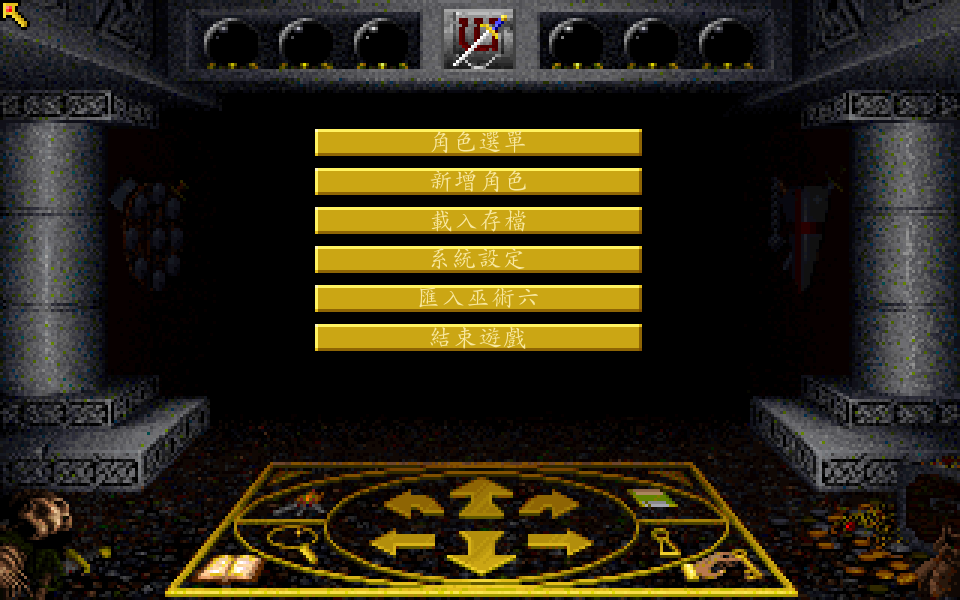
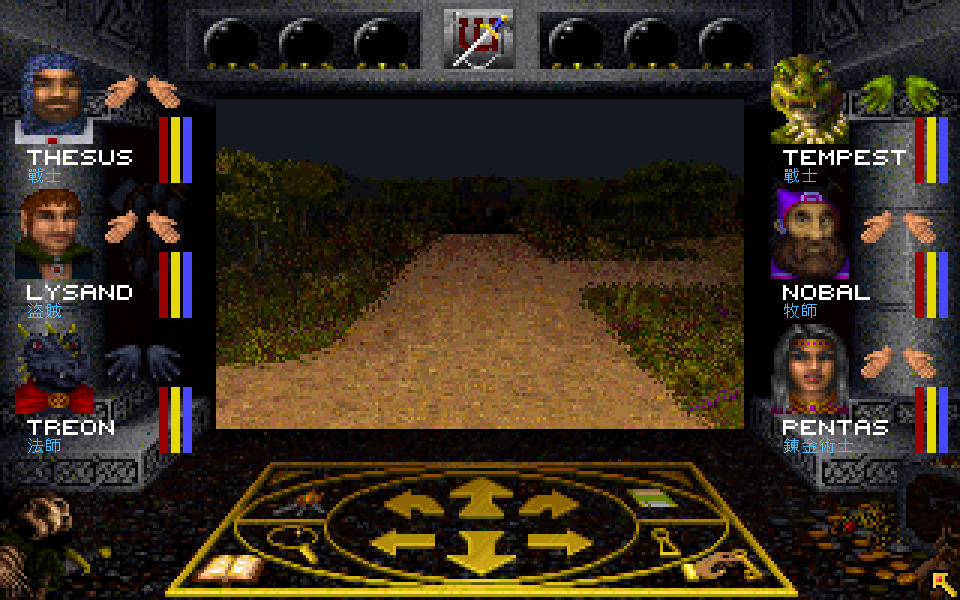
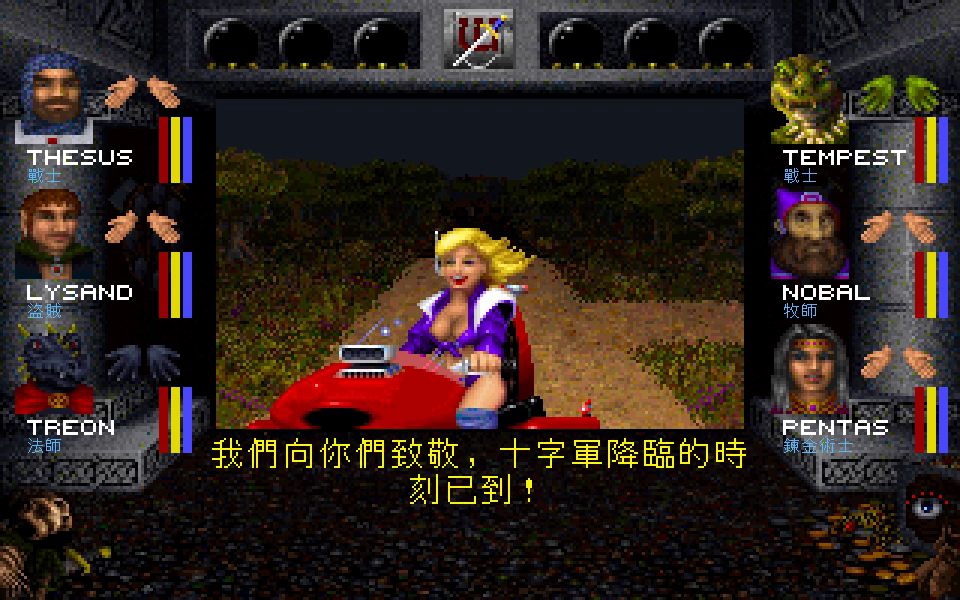
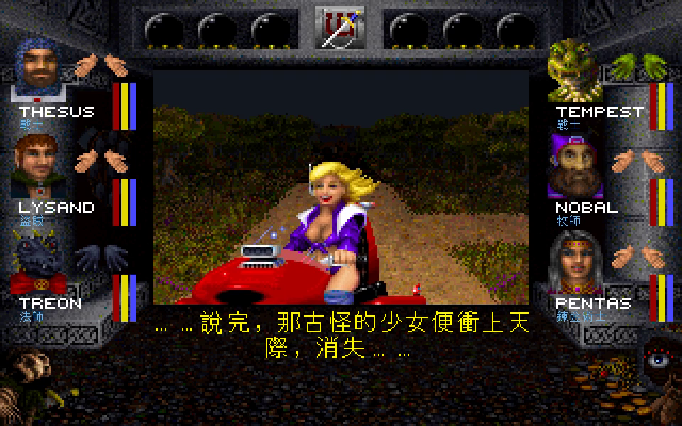
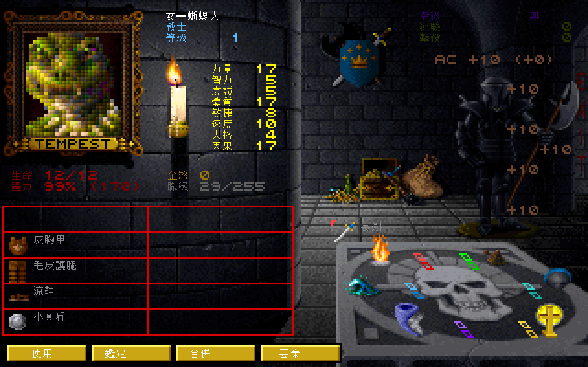
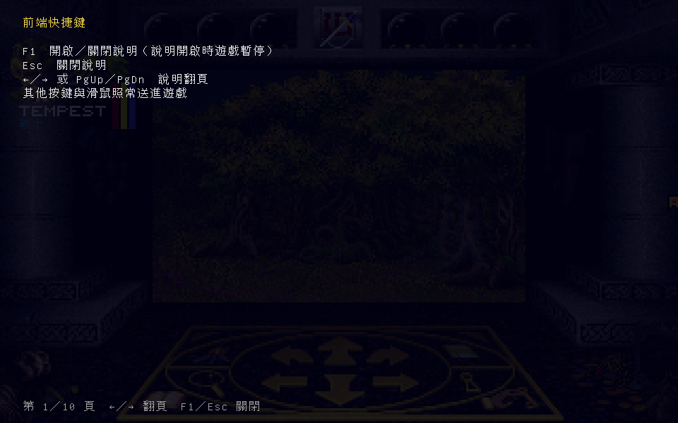

# 巫術7 繁體中文化

《巫術7》（*Wizardry VII: Crusaders of the Dark Savant*，Sir-Tech 1992）是第一人稱迷宮角色扮演遊戲。
玩家組成最多六人的隊伍探索嘉迪亞，尋找失落神器，與來自星際的勢力交涉、交戰。

本專案將DOS原版的選單、劇情與角色資訊覆繪成繁體中文，讓玩家能讀懂對話與線索。
遊戲仍由原版 `DS.EXE` 在 [dosgolem](https://github.com/wicanr2/dosgolem) 上執行。

玩家須自備合法的原版遊戲。可散布發行包不提供原版程式、資料、美術、音樂、手冊或防拷答案。

## 故事背景

《巫術7》接續《巫術6：Bane of the Cosmic Forge》的故事。前作的隊伍追尋「宇宙鍛爐」（Cosmic Forge），一支能改寫時間、空間與命運的魔法筆。這支筆也被用來隱藏一顆行星，使外界無法發現它。筆失竊後，遮蔽行星的力量便無法維持。[^story][^steam]

一艘因導航故障而迷航的採礦船，意外發現了這個不在星圖上的世界。船員返航後，消息傳遍星際：他們找到的可能就是「失落的嘉迪亞」（Guardia），也是傳說中「星界統領」（Astral Dominae）的藏所。各方勢力隨即派人前往，搶在對手之前尋找神器。[^story][^portal]

星界統領的傳說來自藝術家兼科學家豐贊（Phoonzang）。據說，他發現了宇宙與生命的秘密，力量大到足以創造世界，也足以毀掉世界。豐贊擔心成果遭人濫用，便將秘密封存在一顆球形神器中，創造嘉迪亞與守護它的生物，把神器埋藏在這個世界。他留下的地圖被分成許多部分，散落各地，之後便再也沒有人見過他。[^story]

如今追查神器的人之中，有乘著黑船穿行星際的黑暗賢者（Dark Savant）。他的來歷不明，也不向任何勢力效忠。傳聞他早已委託特蘭格（T'Rang）尋找豐贊的世界；這個蛛形種族掌握龐大的星際交易網絡，只要買方付得起價錢，再骯髒的交易也肯接手。[^story]

特蘭格的老對手恩帕尼（Umpani）也介入了。恩帕尼擁有強大的軍事力量，同時經營星際貿易，與特蘭格長年競爭。他們不願讓宿敵獨佔神器，於是也前往嘉迪亞。[^story]

另一個受到注目的人物是戰士薇·多米娜（Vi Domina）。她據說是豐贊的後裔，特蘭格追查她的血統後，她便被帶到黑暗賢者身邊。黑暗賢者相信，她可能知道如何解開星界統領的秘密。她是否自願協助，仍不得而知。[^story]

嘉迪亞的原住民也捲入了這場爭奪。這片土地雖然看似原始，卻有跡象顯示，它曾發展出高度的技術文明。當星際旅客陸續抵達，有些居民開始把來客與古老預言連在一起，懷疑世界末日已經到來。[^story]

玩家的隊伍就在此時抵達嘉迪亞。你可以匯入六代的人物，也可以重新創角，從原作提供的不同開局開始。接下來要穿越森林、城鎮與地下迷宮，蒐集地圖、詢問居民，找出星界統領的下落。其他冒險者也在追查線索；離開後再回來，眼前的情況未必和先前一樣。你如何對待一個人物，也會影響他的同伴是否願意幫忙。[^steam]

中文專名採用本專案的[譯名表](docs/names.md)，背景取自原版開場設定。

[^story]: [原版背景故事轉錄](https://www.tk421.net/wizardry/wiz7story.shtml)。
[^portal]: [Wizardry官方故事介紹](https://wizardry.info/en/product/game/wizardry-7-crusaders-of-the-dark-savant/)。
[^steam]: [原作遊戲介紹](https://store.steampowered.com/app/245430/Wizardry_7_Crusaders_of_the_Dark_Savant/)、[官方商店的前作介紹](https://www.gog.com/en/game/wizardry_6_7)。

## 中文遊戲畫面

以下是已驗收路線的實機畫面，使用Unifont；主選單另用毛筆字型。各圖來源及驗收入口見[截圖來源清單](tools/re/readme_gallery_sources.json)。

主選單：角色管理、存檔與設定選項使用毛筆字。



森林探索：兩側顯示六名隊員的中文職業，人物原名保留。



珍妮特登場：原版完成一段文字輸出後，整段對白顯示中文。



事件末段：離場旁白與最後一句也已中文化。這次事件的八段文字及結束畫面均已驗收，見[事件規格](docs/spec/038-janette-event-text.md)。



人物與裝備：查看中文屬性、物品名稱及使用、鑑定、合併、丟棄等操作。



F1說明：遊戲暫停時，可以用中文查看快捷鍵與操作方式。



## 遊戲與中文化方式

隊伍以第一人稱視角逐格探索，遇敵後進行回合制戰鬥。各角色有自己的種族、職業、技能與裝備。
你要安排誰近戰、誰施法，再依敵人的情況選擇攻擊方式。對話與謎題提供線索，地圖則用來記錄走過的路。

本專案目前支援已驗證的 Interplay《Wizardry Archives》合輯重印版；其他版本的位址與資料尚未驗證。

中文只影響顯示，原版的英文資料、條件判斷、檔名、存檔與規則保持原樣。
覆繪層讀取原版畫面與文字，在放大後的畫布上畫中文；缺譯文時顯示英文並記錄。
對話關鍵字與手冊防拷答案仍照原版要求輸入英文；題目可覆繪中文，驗證機制維持原樣。
作弊功能另有玩家明確觸發與已證實欄位的例外規則，見 [AGENTS.md](AGENTS.md)。


模組邊界與可重建來源見 [adapter 分層證據](docs/re/023-adapter-boundary.md)。

## 目前能做什麼

已驗收的正常路線包含建隊、進入迷宮、中文選單、31頁開場故事、迷宮開場旁白，以及珍妮特八段事件。
已測路線的中英兩種顯示有原版狀態雜湊比對，見[覆繪證據](docs/re/014-overlay-evidence.md)、
[流動文字規格](docs/spec/006-flow-text.md)與[事件規格](docs/spec/038-janette-event-text.md)。

預設畫布為 960×600（3×）。F1 開啟中文說明，F2 開關自動地圖。
本機倚天與發行用Unifont的兩倍率畫面及F1操作已有驗收，見[字型證據](docs/re/018-distributable-font.md)。
片頭六張圖片的「呈獻」也已支援兩套字型與2／3倍顯示；文字區域用周邊紋理近似補底，見[圖片覆繪規格](docs/spec/025-intro-picture-labels.md)。
其他圖片文字與按鈕仍在驗收，新增文字家族須依[字型說明](font/README.md)重建資源。

存檔寫入獨立的可寫目錄。Linux的正常保存與重啟載入已驗，Windows／macOS原生存讀檔仍待確認，見[存檔規格](docs/spec/014-original-save-storage.md)。

全遊戲文字路徑與結局尚未驗收完成，正式 TSV 遷移也還沒完成。開場故事與迷宮旁白依原版分頁覆繪，
但文本表裡有譯文，仍須確認玩家實際走到該處時能正確顯示。三平台本機完整版及推廣片已有交付，公開發行包尚未建立。
完整狀態、證據範圍與限制見 [CONTEXT.md](CONTEXT.md)，待辦以 [GitHub Issue](https://github.com/wicanr2/wizardry7-cht/issues) 為準。

## 開發與本機執行

本機交付版本為 `v.1.0.1-20261010`，含遊戲的四個封包在
`dist-all/v.1.0.1-20261010/full-local/`，分為Linux x64、Windows x64、macOS Intel與Apple Silicon。
2分38秒的有聲推廣片在同版本的`promo/`，包含遊戲與中文化介紹、珍妮特八段完整事件及結束畫面。
大小與SHA-256見版本根的`SHA256SUMS.json`；原1.0.0交付保留。
Linux包已驗正常載入／保存／重啟載入；Windows已驗Wine主選單與正常退出，macOS原生啟動尚待實機。
這些含原版的交付物只留本機，不隨Git散布；重建及驗收入口見[本次交付](docs/goal/R1007-story-features-audio-dialogue.md)。

以下為開發入口。
需要 Docker、本機 `worktrees/dosgolem`、使用者自備原版與字型，以及專案既有的
`wizardry7-go-ebiten`工具鏈映像檔與鎖版離線模組快取。下列入口已驗固定依賴準備，
尚未完成全新環境的工具鏈建置驗收；映像檔來源見[Dockerfile](tools/docker/go-ebiten.Dockerfile)。
音訊相依的dosgolem基線與固定來源列於[來源清單](tools/docker/dosgolem-audio-manifest.json)，
以[準備腳本](tools/docker/prepare-dosgolem.sh)在容器中套用精確差異並核對SHA；
腳本不切換既有分支、不丟棄其他修改。建置經 [tools/fe.sh](tools/fe.sh) 的 Docker 工具鏈。

```bash
git clone https://github.com/wicanr2/dosgolem.git worktrees/dosgolem
git -C worktrees/dosgolem switch -c wiz7-cht-opl-stream d16f03a2d8d782024d470606e1f4cb5272b89cd6
tools/docker/prepare-dosgolem.sh
tools/fe.sh build ./cmd/wiz7
```

前端測試或需要虛擬桌面的命令使用以下入口；Xvfb與命令都在容器內執行：

```bash
tools/fe.sh xvfb 'go test ./cmd/wiz7'
```

入口預設離線、Go模組唯讀，每次執行有獨立容器與資源上限；原版ZIP及
`workplace/original`若已存在，會另掛唯讀。`WIZ7_FE_TIMEOUT`可指定正整數逾時
（預設`10m`），`WIZ7_FE_IMAGE`可選已備妥的工具鏈映像檔。
映像檔或Docker查詢失敗即停止，不自動下載或建置；模組快取須事先備妥。
既有`WIZ7_FE_SH='指令' tools/fe.sh`用法仍可在容器Xvfb內執行。

上述clone與分支命令供新環境使用；既有工作樹依[CONTEXT.md](CONTEXT.md)核對，不覆寫。
互動前端預設按原版虛擬時鐘同步；明示`-ips`可手動加速，音樂維持音高，`-mute`關閉裝置播放。
音訊仍在正式驗收階段，已量範圍與限制見[規格009](docs/spec/009-player-audio.md)。

主程式入口為 `cmd/wiz7`，原版唯讀素材以 `-root` 指定，預設 `workplace/run`；
譯文與字形重建方式見 [tools/re/bake_font.py](tools/re/bake_font.py)、[tools/re/bake_flow.py](tools/re/bake_flow.py) 及 [tools/re/bake_help.py](tools/re/bake_help.py)。
烘製支援本機倚天與固定版GNU Unifont，來源、授權、字元清單與重建入口見[字型說明](font/README.md)。
倚天 `stdfont.15` 與符號字型僅供本機；正式封包採Unifont並保留OFL與著作權。
這些開發工具不構成已驗收的跨平台安裝流程。

### 輸入錄製與重播

可錄放版本由[build_recording.py](tools/re/build_recording.py)建置，將當次實際選定來源綁入程式。
普通`go build`缺少這份身份時可遊玩，但會拒絕錄放。沿上述Docker入口，先建立新的輸出目錄：

```bash
WIZ7_FE_IMAGE=wizardry7-go-ebiten:go1.24.13-20261008-gui-r1 \
  tools/fe.sh xvfb 'mkdir workplace/recording-build'
WIZ7_FE_IMAGE=wizardry7-go-ebiten:go1.24.13-20261008-gui-r1 \
  tools/fe.sh xvfb 'python3 tools/re/build_recording.py --output /src/workplace/recording-build/wiz7 --receipt-dir /src/workplace/recording-build'
```

以產出的程式加`-record <檔名>`開始錄製，按遊戲區外的「停止錄製」按鈕收尾，之後仍可續玩。
重播改用`-replay <檔名>`；兩者互斥。錄放檔須放在原版素材與存檔目錄之外，可能含玩家輸入及防拷答案，只留本機。
重播需要同一程式、平台、資源及相符的起始存檔副本；錄製前先備份存檔目錄，三次重播各用乾淨副本。
新版本不承諾重播舊版收據。正式格式、限制及已量路線見[013](docs/spec/013-input-recording.md#r951-production-contract)、
[錄放證據](docs/re/022-input-recording-boundary.md)。

### 原版存檔位置

存檔預設放在使用者資料目錄，更新程式不會改變這個位置。啟動時會印出實際路徑。

| 平台 | 預設位置 |
|---|---|
| Linux | `$XDG_DATA_HOME/wizardry7-cht/save`；未設定或不是絕對路徑時採 `~/.local/share/wizardry7-cht/save`。 |
| Windows | 系統的LocalAppData資料夾下 `wizardry7-cht\save`，通常為 `%LOCALAPPDATA%\wizardry7-cht\save`。 |
| macOS | `~/Library/Application Support/wizardry7-cht/save`。 |

`-save-dir`可指定另一個獨立目錄。備份整個存檔目錄即可；保存與載入仍由原版選單操作。
存檔目錄不能與原版素材重疊，無法讀寫時程式會明確停止，不會顯示保存成功卻只記帳。
`tools/fe.sh`的開發容器使用暫存HOME；在容器試玩時，請指定工作樹內的持久路徑，
例如`-save-dir /src/workplace/player-save`，以保留容器結束後的進度。

原版檔案基線見 [001 原版基線](docs/re/001-unzip-baseline.md)，其中：

| 檔案 | 大小 | SHA-256 |
|---|---:|---|
| `DS.EXE` | 69,206 bytes | `14a94f85cb4ef4df08566ed165dddc88c363aa816360c6509b84f079866a43db` |

## 文件入口

- [CONTEXT.md](CONTEXT.md)：目前真相、限制與最近交接。
- [PLAN.md](PLAN.md)：穩定路線與分期完成條件。
- [WORKLOG.md](WORKLOG.md)：歷程與舊結論勘誤。
- [目標與驗收](docs/goal/README.md)、[輸出路徑規格](docs/spec/)、[研究證據索引](docs/re/README.md)。
- [譯名表](docs/names.md) 與 [翻譯指令](text/TRANS-INSTRUCTIONS.md)。
- [字型來源與重建](font/README.md)。

## 授權

本專案採 [RRSAL-1.0](LICENSE)：非商業使用免費，允許修改與再散布，
實況、錄影、截圖與教學明示允許；修改後散布須提供原始碼與修改說明，貢獻回授本專案。
商業使用另洽 wicanr2@gmail.com，完整條款以 LICENSE 為準。

授權不涵蓋原版素材與第三方字型。本專案與 Sir-Tech、Interplay 沒有隸屬、合作、贊助或授權關係。
